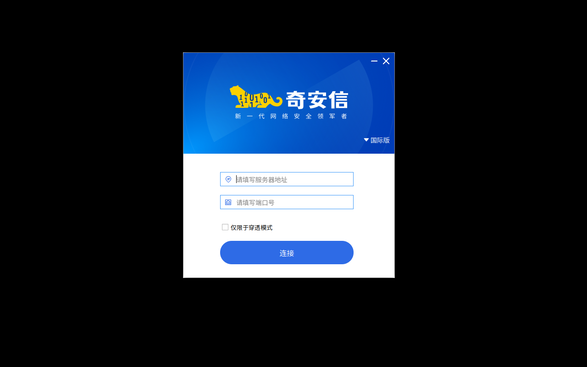

# secgate-vpn-docker

[](https://github.com/zgs225/secgate-vpn-docker/actions/workflows/docker.yml)

把**奇安信（网神）SecGate Access**（SD-WAN / SSL VPN）客户端塞进容器：容器内跑
Xvfb + noVNC 提供浏览器桌面，用它完成登录（含**二次认证**）；同时跑 `microsocks`
对外提供 SOCKS5，登录成功后容器内流量走客户端建立的 `tun0` 进入内网。

定位与「VPN 客户端进容器 + 暴露 socks」这类镜像（如 `docker-atrust`、`docker-easyconnect`）
一致，只是厂商换成了奇安信。



## 为什么要用图形端

命令行版（`sslvpnclient` 的 `secgateaccess`）在开启二次认证的网关上走不通，实测现象：

```
log.txt: <info>  Connect server success
         <error> Login error .        ← %s 为空，且不打印到终端、进程不退出（停在 poll 里空转）
```

- TCP/TLS 能连上，`/service` 是 XML-RPC 端点（非法请求会返回 `faultCode 1677 / SSL协议封装错误`）
- `Login error %s` 的 `%s` 取自客户端内置码表（`用户名或密码错误`/`SSL用户锁定`/`证书无效`…），
  为空说明服务端返回的码不在表里
- 二次认证没有对应的输入入口 → 认证必被拒

图形端（Qt5 + QML）登录后会弹二次认证窗口，是唯一能走完流程的实现，所以本项目以图形端为主。
曾验证过的命令行版镜像已从仓库移除（走不完认证流程的镜像没有保留价值），上面的结论留作背景。

## 客户端来源

| 项 | 值 |
|---|---|
| 产品 | 奇安信 SecGate Access（SD-WAN / NGFW 的 SSL VPN · ZTNA 客户端） |
| 下载站 | https://sdwanapp.qianxin.com/download.html?product-type=sdwan |
| 包（amd64） | `download/sdwan-v6.0/hygon_kylin/KYLIN-X86_SDWANClient_Setup.deb`（「海光麒麟」GUI） |
| 包（arm64） | `download/sdwan-v6.0/kunpeng_kylin/KYLIN-ARM_SDWANClient_Setup.deb`（「鲲鹏麒麟」GUI；「飞腾麒麟」用同一个文件） |
| 版本 / 校验 | amd64 `sslvpnclient 1.1.3.1010701` / md5 `49e3472a779e62be596117e4cefaee4a`<br>arm64 `sslvpnclient 1.1.5.1010901` / md5 `5d3ea8c60927bc902a166f14b6cbacd6` |
| 包结构 | linuxdeployqt 打包：`files/bin/sslvpn` + `libsslvpnsdk.so` + 自带 Qt5/字体，落盘 `/opt/sslvpnclient`；两个架构都是**原生**二进制 |

> 厂商的安装包**不入库**（本仓库不转发第三方二进制）。第一次构建前先取包：
>
> ```bash
> make fetch        # → vendor/ 里本机架构的包（带 md5 校验）
> make fetch-all    # amd64 + arm64 都取（多架构构建/CI 用）
> ```
>
> 详见 `vendor/README.md`。

## 架构

```
浏览器 ──http──▶ websockify:6080 ──▶ x11vnc:5900 ──▶ Xvfb :1 ──▶ 客户端窗口(sslvpn)
                                                        └─ openbox（弹窗/对话框靠它）
容器内 microsocks:1080 ──▶ 客户端建好的 tun0 ──▶ 内网（网关下发的网段）
```

## 目录

```
Dockerfile            图形端镜像（ubuntu24.04 + 麒麟 GUI 包 + Xvfb/noVNC + microsocks）
docker-entrypoint.sh  起 Xvfb/openbox/x11vnc/websockify/microsocks，再拉起 GUI（崩溃自启）
docker-compose.yml    secgate-gui
Makefile               make help 看全部
.github/workflows/docker.yml  main 分支构建 amd64+arm64 镜像并发布到 ghcr.io
scripts/verify.sh      只读自检（含自动截图）
scripts/smoke-image.sh 运行时冒烟（临时起容器验证 X/noVNC/SOCKS/GUI）
scripts/deploy-nas.sh  部署到 NAS（Synology）并（重）建容器
scripts/fetch-client-deb.sh  从官方下载站取厂商 deb（amd64 / arm64，带 md5 校验）
scripts/export-clash-ruleset.sh  tun0 路由 → clash/mihomo ipcidr ruleset
LICENSE                MIT
vendor/                安装包放这里（不入库，见 vendor/README.md）
runtime/ log/ root-home/  登录态、日志、GUI 家目录（已 gitignore）
```

## 镜像（GitHub Container Registry）

`main` 分支每次推送由 GitHub Actions（[`.github/workflows/docker.yml`](.github/workflows/docker.yml)）
构建并发布到 GHCR，不用本地取包也能直接用：

```bash
docker pull ghcr.io/zgs225/secgate-vpn-docker:latest
```

| tag | 说明 |
|---|---|
| `latest` | `main` 最新构建 |
| `sha-xxxxxxx` | 每次提交一个，便于回滚/复现 |
| `1.2.3` / `1.2` | 打 `v1.2.3` tag 时额外产生 |

**多架构**：同一个 tag 下是 `linux/amd64` + `linux/arm64` 的 manifest list，`docker pull`
按宿主架构自动选。两边都用厂商**原生**包（amd64 海光麒麟 / arm64 鲲鹏麒麟），不靠 qemu 计
译。两个包的客户端小版本不同（厂商各自打包），所以 tag 里不带客户端版本号；实际版本看
镜像里的 `/opt/sslvpnclient/.client-version`（启动日志会打一行）。

CI 说明：

- 厂商 deb **不入库**，workflow 跑 `scripts/fetch-client-deb.sh all` 取两个包并校验 md5，
  命中 `actions/cache` 时跳过这 100 MB 下载
- arm64 的 RUN 步骤在 amd64 runner 上由 `docker/setup-qemu-action` 模拟
- PR 不推送：amd64 载入后跑 `scripts/smoke-image.sh`；另有**原生 arm64 runner**
  （`ubuntu-24.04-arm`）跑同一套冒烟（Xvfb/noVNC/SOCKS5/GUI 进程 + ELF 架构匹配）
- 仓库是 public，包随仓库公开可匿名拉取（这一点已用空凭据 `docker pull` 验证过）；
  如果以后把仓库或包改成私有，其它机器上就要 `docker login ghcr.io`
  （PAT 至少带 `read:packages`）

## 用法（本机）

不想本地构建（不装 deb、不需要 docker build）：

```bash
make pull       # 拉 ghcr.io/zgs225/secgate-vpn-docker:latest
make up         # 启动
make url        # http://127.0.0.1:6080/vnc.html
```

从源码构建（等于把同一个 ghcr tag 打在本地）：

```bash
make fetch      # 先取本机架构的厂商包（vendor/*.deb 不入库，arm64 主机会取 ARM 包）
make build      # 构建 ghcr.io/zgs225/secgate-vpn-docker:latest
make up         # 启动
make shot       # 截一张当前桌面到 screenshots/（不开浏览器也能看状态）
make window     # 列 X 窗口，确认客户端窗口在
make verify     # 全套自检（在已启动的容器上）
make smoke      # 运行时冒烟（自己起临时容器，不碰现有容器）
make logs       # 容器日志
```

浏览器打开 `http://127.0.0.1:6080/vnc.html` → 点 Connect（noVNC 里不需要密码）：

1. 右上角下拉选「国内版 / 国际版」（按网关部署选）
2. 填服务器地址 / 端口号 → 连接
3. 输账号密码 → 出现二次认证窗口，输入短信/OTP 码
4. 成功后 `make verify` 应看到 `tun0` 与网关下发的路由

走代理：

```bash
curl --socks5-hostname 127.0.0.1:1080 http://<内网地址>/
# 或者让其它容器共享网络命名空间
#   network_mode: "service:secgate-gui"
```

## 部署到 NAS（Synology 等）

```bash
NAS_HOST=nas make nas-deploy              # 幂等：NAS 上已有镜像就跳过，否则先在 NAS 上 docker pull
NAS_HOST=nas FORCE_PUSH=1 make nas-deploy # 本地构建后强制 save/load 过去（跳过 pull）
```

- 默认部署 `ghcr.io/zgs225/secgate-vpn-docker:latest`：先看 NAS 上有没有，没有就在 NAS 上
  `docker pull`（公开包匿名可拉；还是私有包就得先在 NAS 上 `sudo docker login ghcr.io`）
- 拉不到才退回本机 `docker save | ssh | docker load`（此时本机要有镜像，`make build`/`make pull`）
- 固定版本：`NAS_HOST=nas IMAGE=ghcr.io/zgs225/secgate-vpn-docker:sha-abc1234 make nas-deploy`

- 宿主机只需 `docker`/Container Manager，且内核有 `tun`（`ls /dev/net/tun`）
- 镜像是多架构的，NAS（amd64）上 `docker pull` 会自动挑 `linux/amd64` 那层
- 默认发布 `127.0.0.1:1080 → 容器 1080`（SOCKS5）、`127.0.0.1:6080 → 容器 6080`（noVNC），
  用 `SOCKS_PORT` / `VNC_PORT` 覆盖；端口别和宿主上已有的 VPN 容器撞车
- **两个端口都没有认证**：默认只绑 NAS 回环，本机访问走 SSH 隧道。
  `BIND_ADDR=0.0.0.0` 会把桌面和 SOCKS5 暴露给能连到 NAS 的任何人，脚本会告警
- 数据目录 `NAS_BASE`（默认 `/volume2/docker/secgate-vpn`）
- noVNC 地址（走隧道后）：`http://127.0.0.1:6080/vnc.html`

NAS 上验证：

```bash
ssh "$NAS_HOST" 'sudo docker ps --filter name=secgate-gui'
ssh -N -L 6080:127.0.0.1:6080 -L 1080:127.0.0.1:1080 "$NAS_HOST" &      # 隧道
curl -s -o /dev/null -w '%{http_code}\n' http://127.0.0.1:6080/vnc.html # 200
curl --socks5-hostname 127.0.0.1:1080 http://<内网地址>/                # 登录后 200
```

## 接入 Clash / mihomo

网关下发的路由用脚本导出，不要手写：

```bash
# 已登录的前提下，把你的 LAN 段排除掉（换成你自己的网段）
EXCLUDE_CIDRS='192.168.0.0/16,10.0.0.0/8' make ruleset > qax.yml
```

- `EXCLUDE_CIDRS`：**必须**把你自己办公/家里的 LAN 段排除，否则网关下发的
  `192.168.0.0/16` 之类汇总路由会把本地网络也一起吞进 VPN
- 脚本还会自动排除 `tun0` 自身所在的那个 `/24`
- 导出的文件是 `behavior: ipcidr` 的 rule-provider 格式：

```yaml
payload:
  - "192.0.2.0/24"
  - "198.51.100.0/24"
```

对应的 mihomo 配置（示例）：

```yaml
proxies:
  - name: qax-vpn-local
    type: socks5
    server: 127.0.0.1
    port: 1080
  - name: qax-vpn-nas
    type: socks5
    server: <NAS_IP>
    port: 1080

proxy-groups:
  - name: qax-vpn
    type: select
    # url 指向只有内网可达的地址，可用于探测
    url: http://<内网地址>/
    interval: 300
    proxies: [qax-vpn-local, qax-vpn-nas, DIRECT]

rule-providers:
  qax:
    type: http
    behavior: ipcidr
    url: "<你托管 ruleset 的地址>/qax.yml"
    path: ./ruleset/qax.yml
    interval: 86400

rules:
  - RULE-SET,qax,qax-vpn
```

> 规则顺序很重要：把 `RULE-SET,qax,qax-vpn` 放在 `GEOIP,LAN,DIRECT`、`RULE-SET,lancidr,DIRECT`
> 之类的直连规则**之前**，或把 qax 规则放进 profile 的 `extra_rules` 最前面。

## 人工验证清单

1. `make pull` 或 `make build` 成功（镜像里 `dpkg -i` 无报错）
2. `make up && make verify` 全绿（未登录时「无 tun0」正常）
3. `make shot` 截图里能看到奇安信登录窗口，**中文不是「口口」**
4. noVNC 能操作（键盘/鼠标），能切换「国内版/国际版」
5. 登录 → 二次认证 → 提示连接成功
6. `make verify`：`tun0` 存在，路由与网关下发的网段一致
7. `curl --socks5-hostname 127.0.0.1:1080 http://<内网服务>/` 通
8. `make restart` 后服务器地址/账号仍记得（`runtime/` + `root-home/` 卷）
9. 断开连接 → `tun0` 消失、路由复原

## 常见问题

- **中文显示成「口口」** — 客户端自带的思源黑体默认没注册进 fontconfig。镜像构建时已把
  `files/bin/lib/fonts/*.ttf` 拷到 `/usr/local/share/fonts/sslvpn` 并 `fc-cache -f`。
- **窗口是纯黑/没有界面** — 看 `make logs`：Xvfb 是否就绪、`x11vnc`/`websockify` 是否在跑；
  Qt Quick 已在 Xvfb 下走软件渲染（`QT_QUICK_BACKEND=software`、`LIBGL_ALWAYS_SOFTWARE=1`）。
- **二次认证窗口不出现** — 缺窗口管理器时有些弹窗不显示，镜像里已带 `openbox`。
- **会话会自己掉** — 客户端日志（`log/sslvpnSdk.log`）出现 `heartbeat timeout` 时隧道被拆、
  路由被清，界面退回登录页（服务器地址/端口保留），**不会自动重连**，需要再点一次「连接」
  并重新过二次认证。
- **noVNC / SOCKS 没有认证** — 默认只绑回环或仅在内网。要在别的机器用请走 SSH 隧道：
  `ssh -L 6080:127.0.0.1:6080 -L 1080:127.0.0.1:1080 <本机>`，不要直接暴露到公网。
- **需要命令行版** — 不提供。CLI 端在开二次认证的网关上进不了隧道，镜像也就不保留。
- **arm64 主机** — 厂商有原生 arm64 包（鲲鹏/飞腾麒麟），`make fetch` 会按本机架构
  自动取 ARM 包，`make build` 直接能出 arm64 镜像；预构建镜像也是双架构，`docker pull`
  自动选。不需要 `platform: linux/amd64` + qemu 转译。

## 免责声明

- 本项目与奇安信科技集团无关，未获其授权或背书；SecGate / aTrust 等名称与客户端的
  版权归各自厂商所有。
- 仓库不包含任何厂商客户端二进制，`vendor/` 与镜像均由使用者自行从官方下载站获取。
- 仅用于访问**你自己有权访问**的网络；请遵守所在组织的网络安全策略。
- 代码部分以 MIT 许可证发布，见 [LICENSE](LICENSE)。
